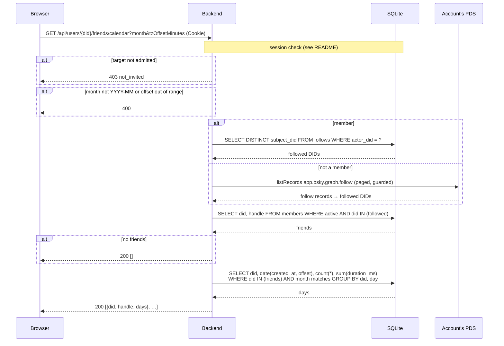

# `GET /api/users/{did}/friends/calendar`

Practice days in one month for each Voicebook member an account follows, in
the viewer's time zone. Powers the friend dots on the Practice view's
calendar and the friend picker beneath it.

Every followed member is listed, including those who didn't practice that
month, so the viewer can choose whose practice to show. Which friends are
hidden is a per-browser preference (`localStorage`), not stored here.

- **Auth:** session; the account read must also be admitted.
- **Implemented in:** `friends_calendar` in `backend/src/api.rs`;
  `Indexer::follows_of` in `backend/src/indexer.rs`.

## Request

```http
GET /api/users/did%3Aplc%3Awzraxbnzzz4fxt72jhvuswbb/friends/calendar?month=2026-10&tzOffsetMinutes=-420
Cookie: __Host-vb_session=…
```

`month` and `tzOffsetMinutes` work as for
[the calendar](user-calendar.md#request).

## Response

`200 OK`, one entry per followed active member, sorted by handle; each
member's `days` are as in [the calendar](user-calendar.md#response):

```json
[
  {
    "did": "did:plc:3qrhneybizwlxs5ar3updfjq",
    "handle": "bob.test",
    "days": [
      { "date": "2026-10-04", "recordingCount": 2, "durationMs": 9000 }
    ]
  },
  { "did": "did:plc:ry4hmzw4pmyjfvsqtzhhg3cp", "handle": "dave.test", "days": [] }
]
```

Empty if the account follows no members. The account itself is never
included.

## Where the follows come from

As for [friends activity](user-friends-activity.md#where-the-follows-come-from):
from the index for members, fetched live from the PDS (SSRF-guarded) for
accounts that aren't members yet.

## Errors

| Status | `error` | When |
|---|---|---|
| 400 | `expected month=YYYY-MM and \|tzOffsetMinutes\| <= 840` | Bad parameters |
| 401 | `not_signed_in` | No valid session |
| 403 | `not_invited` | The caller's or the target's account isn't admitted |
| 500 | `internal error` | The database can't be read, or the live follow fetch fails |

## Sequence


