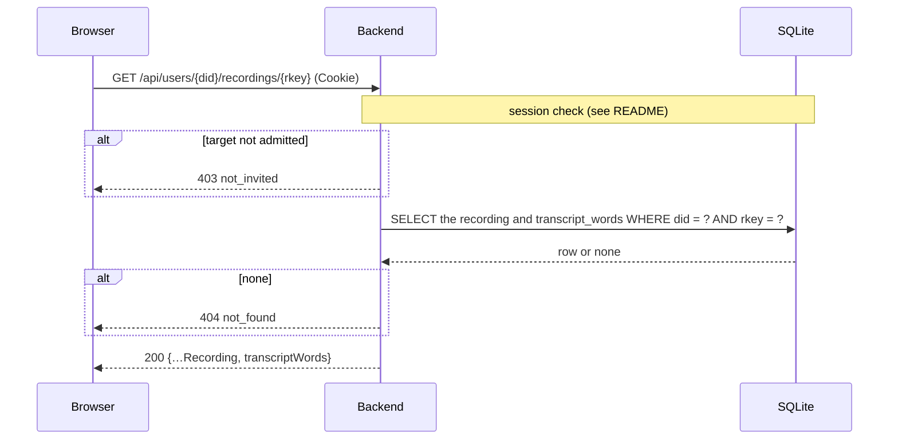

# `GET /api/users/{did}/recordings/{rkey}`

One recording, with its transcript's word timings. The details panel loads
it when a recording is opened; lists leave the timings out, as they can be
large.

- **Auth:** session; the account read must also be admitted.
- **Implemented in:** `recording` in `backend/src/api.rs`.

## Request

```http
GET /api/users/did%3Aplc%3Awzraxbnzzz4fxt72jhvuswbb/recordings/3mx4no3nu4c22
Cookie: __Host-vb_session=…
```

`rkey` is the last part of the recording's AT URI.

## Response

`200 OK`: a [Recording](README.md#recording) plus `transcriptWords`:

```json
{
  "uri": "at://did:plc:wzraxbnzzz4fxt72jhvuswbb/club.voicebook.recording/3mx4no3nu4c22",
  "…": "…",
  "transcript": "It is a truth universally acknowledged.",
  "transcriptWords": [
    { "text": "It", "startMs": 0, "endMs": 250 },
    { "text": "is", "startMs": 300, "endMs": 550 }
  ]
}
```

`transcriptWords` is null if the transcript has no word timings, or if any
of them were malformed. The timings are for the words as transcribed: if
the reader edited the text afterwards, `transcript` and the words differ.

## Errors

| Status | `error` | When |
|---|---|---|
| 401 | `not_signed_in` | No valid session |
| 403 | `not_invited` | The caller's or the target's account isn't admitted |
| 404 | `not_found` | No such recording in the index |
| 500 | `internal error` | The database can't be read |

## Sequence


